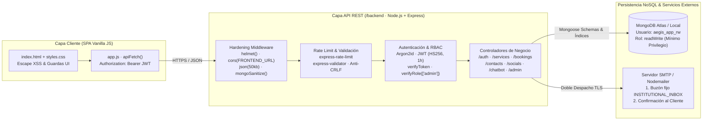

# AegisSec Enterprise · Plataforma Web Segura, NoSQL & DevSecOps

Plataforma web integral desarrollada para el **Certamen Práctico Integrador** de **Desarrollo Web Seguro y DevSecOps**. Implementa una arquitectura desacoplada en tres capas (SPA Vanilla JS + API REST Node.js/Express + MongoDB/Mongoose) con autenticación **JWT + Argon2id**, control de acceso basado en roles (**RBAC**), doble notificación transaccional **SMTP (Nodemailer)**, validación anti-inyección NoSQL/XSS/CRLF y un pipeline **CI/CD DevSecOps** automatizado en GitHub Actions.

---

## 1. Identificación del Equipo y Asignatura

| Campo | Detalle |
| :--- | :--- |
| **Institución / Facultad** | Universidad Católica de la Santísima Concepción (UCSC) · Facultad de Ingeniería |
| **Asignatura** | Desarrollo Web Seguro y DevSecOps |
| **Docente Evaluador** | `[COMPLETAR: Nombre del Docente]` |
| **Integrante 1 (Líder Técnico / Backend)** | `[COMPLETAR: Nombre Completo · RUT / Matrícula · Correo Institucional]` |
| **Integrante 2 (Seguridad / DevSecOps)** | `[COMPLETAR: Nombre Completo · RUT / Matrícula · Correo Institucional]` |
| **Integrante 3 (Frontend / Base de Datos NoSQL)** | `[COMPLETAR: Nombre Completo · RUT / Matrícula · Correo Institucional]` |
| **URL Repositorio GitHub** | `[COMPLETAR: https://github.com/usuario/certamen-web-seguro]` |
| **URL Despliegue Producción (HTTPS)** | `[COMPLETAR: https://aegissec-enterprise.onrender.com]` |

---

## 2. Contexto del Caso de Negocio y Justificación Arquitectónica

### 2.1. Problema de Negocio: AegisSec Enterprise
Las organizaciones financieras, EdTech y corporativas suelen gestionar sus requerimientos de auditorías de ciberseguridad (Pentesting OWASP, endurecimiento Cloud y revisiones CI/CD) a través de correos electrónicos dispersos o formularios sin trazabilidad ni controles criptográficos.

**AegisSec Enterprise** resuelve esta problemática centralizando en un único portal seguro:
1. **Catálogo público dinámico de servicios** de ciberseguridad con búsqueda instantánea.
2. **Gestión de solicitudes y reservas de consultoría** aisladas por cliente mediante firma JWT.
3. **Formulario de contacto endurecido** con desafío matemático firmado (CAPTCHA stateless), Rate Limiting antispam, filtro anti-CRLF y **doble despacho de correo vía Nodemailer** (hacia el buzón institucional fijo y acuse de recibo automático al visitante).
4. **Asistente virtual (AegisBot)** alimentado dinámicamente desde MongoDB con bloqueo de comandos administrativos y auditoría de consultas.
5. **Panel de Gobernanza Administrativa y NoSQL** exclusivo para el rol `admin` (RBAC), con gestión de usuarios, CRUD de servicios, bandeja de tickets, enlaces de redes sociales validados bajo `https://`, reglas del chatbot y exportación de respaldos JSON.

### 2.2. Justificación Arquitectónica del Frontend sin Dependencias Externas
El frontend (`index.html`, `styles.css`, `app.js`) fue diseñado deliberadamente en **HTML5 semántico, CSS3 moderno y Vanilla JavaScript (ES2022+) sin frameworks ni paquetes de terceros en el cliente** por tres razones fundamentales de seguridad y rendimiento:
- **Reducción drástica de la superficie de ataque SCA (Supply Chain Security):** Al no incluir decenas de dependencias transitivas de UI en el navegador, se elimina el riesgo de vulnerabilidades XSS en librerías de terceros y ataques de cadena de suministro en el bundle cliente.
- **Transparencia y auditabilidad para SAST/DAST:** Todo el ciclo de sanitización (`escapeHtml`, `stripHeaderInjection`), manejo del token Bearer en `apiFetch()` e inspección del JWT es 100% trazable y auditable por **GitHub CodeQL** y **OWASP ZAP**.
- **Desempeño y portabilidad:** Carga instantánea sin pasos de transpilación complejos en el cliente, delegando toda la lógica sensible, validación de negocio, hashing Argon2id y control de acceso al backend en `/backend`.

---

## 3. Arquitectura del Sistema y Controles de Seguridad



---

## 4. Modelo de Datos NoSQL (MongoDB + Mongoose)

La base de datos opera bajo el **Principio de Mínimo Privilegio**, utilizando un usuario de aplicación dedicado (`aegis_app_rw`) con permisos restringidos exclusivamente a `readWrite` sobre la base de datos del proyecto (sin privilegios `atlasAdmin` ni `dbAdmin`).

### 4.1. Colecciones, Esquemas e Índices

| Colección | Modelo Mongoose | Campos Principales | Índices Definidos | Controles de Seguridad en Esquema |
| :--- | :--- | :--- | :--- | :--- |
| `users` | `User` (`src/models/User.js`) | `name`, `email`, `passwordHash`, `role` (`'admin' \| 'usuario'`), `createdAt` | `{ email: 1 }` (**Unique**) | `passwordHash` con `select: false`; `email` normalizado en `lowercase`. |
| `services` | `Service` (`src/models/Service.js`) | `title`, `category`, `price`, `description` | `{ _id: 1 }` | `trim: true` y límites estrictos `maxlength`. |
| `bookings` | `Booking` (`src/models/Booking.js`) | `userId` (`ObjectId` ref `User`), `userName`, `userEmail`, `serviceTitle`, `preferredDate`, `priority`, `notes`, `status`, `createdAt` | `{ userId: 1, createdAt: -1 }` (**Compuesto**) | Vinculación estricta al `sub` del JWT para evitar IDOR; `status` por defecto `'Pendiente Revisión'`. |
| `contacts` | `Contact` (`src/models/Contact.js`) | `ticketId`, `name`, `email`, `phone`, `subject`, `message`, `smtpInstitutionalSent`, `smtpClientCopySent`, `createdAt` | `{ createdAt: -1 }` | Limpieza previa de `\r\n` (Anti-CRLF) y trazabilidad booleana de ambos envíos SMTP. |
| `socials` | `Social` (`src/models/Social.js`) | `network`, `url`, `active` | `{ _id: 1 }` | Validador personalizado que exige prefijo `https://` para mitigar enlaces inseguros o `javascript:`. |
| `chatbot_faqs` | `ChatbotFaq` (`src/models/ChatbotFaq.js`) | `category`, `keywords`, `question`, `answer`, `active` | `{ active: 1, category: 1 }` (**Compuesto**) | Separación entre consulta pública (solo `active: true`) y administración completa. |
| `chatbot_logs` | `ChatbotLog` (`src/models/ChatbotLog.js`) | `query`, `matchedCategory`, `timestamp` | `{ _id: 1 }` | Registro de auditoría de consultas y bloqueos por intento de comandos administrativos. |

### 4.2. Comandos de Respaldo y Restauración NoSQL

Además del endpoint administrativo `GET /api/admin/backup` (que exporta un archivo JSON firmado sin exponer `passwordHash`), la base de datos puede respaldarse y restaurarse mediante las herramientas oficiales de MongoDB Database Tools:

```bash
# 1. Generar respaldo binario completo (mongodump) - Evidencia guardada en ./evidencia/backup_nosql/mongodump_binario/
mongodump --uri="mongodb://127.0.0.1:27017/aegissec_db" --out="./evidencia/backup_nosql/mongodump_binario"

# 2. Restaurar respaldo binario (mongorestore)
mongorestore --uri="mongodb://127.0.0.1:27017/aegissec_db" --drop "./evidencia/backup_nosql/mongodump_binario/aegissec_db"

# 3. Exportar una colección específica en formato JSON legible (mongoexport) - Evidencia en ./evidencia/backup_nosql/bookings_export.json
mongoexport --uri="mongodb://127.0.0.1:27017/aegissec_db" --collection=bookings --out="./evidencia/backup_nosql/bookings_export.json" --jsonArray --pretty

# 4. Generar respaldo JSON consolidado sin exponer passwordHash (script automatizado)
npm --prefix backend run backup
```

---

## 5. Instalación Local y Puesta en Marcha Paso a Paso

### 5.1. Prerrequisitos
- **Node.js** v20 LTS o superior (probado en Node v20 y v24).
- **MongoDB** en ejecución local (`mongodb://127.0.0.1:27017`) o cluster en **MongoDB Atlas**.

### 5.2. Variables de Entorno (`backend/.env`)
Copia el archivo de plantilla `backend/.env.example` hacia `backend/.env`:

```bash
cp backend/.env.example backend/.env
```

Listado de variables requeridas (sin secretos expuestos en el repositorio):

| Variable | Ejemplo / Valor por Defecto | Descripción Técnica |
| :--- | :--- | :--- |
| `PORT` | `4000` | Puerto HTTP donde escucha el servidor Express. |
| `NODE_ENV` | `development` (`production` en nube) | Define el modo de ejecución; en `production` oculta stacktraces internos. |
| `MONGO_URI` | `mongodb://127.0.0.1:27017/aegissec_db` | Cadena de conexión a MongoDB local o MongoDB Atlas (`aegis_app_rw`). |
| `JWT_SECRET` | `<cadena_aleatoria_min_32_caracteres>` | Secreto criptográfico HMAC-SHA256 para firmar y verificar tokens JWT y CAPTCHA. |
| `JWT_EXPIRES_IN` | `1h` | Tiempo de vida del token de acceso JWT. |
| `FRONTEND_URL` | `http://localhost:5500` | Origen permitido estrictamente en la política CORS del backend. |
| `SMTP_HOST` | `smtp.gmail.com` / `sandbox.smtp.mailtrap.io` | Host del servidor SMTP (si se omite en local, activa `jsonTransport` de respaldo). |
| `SMTP_PORT` | `587` | Puerto SMTP (`587` STARTTLS o `465` TLS implícito). |
| `SMTP_USER` | `usuario_smtp` | Usuario de autenticación SMTP. |
| `SMTP_PASS` | `<secreto_smtp>` | Contraseña o App Password SMTP. |
| `INSTITUTIONAL_INBOX` | `contacto@aegissec.cl` | Destinatario institucional fijo en servidor (inmutable desde el cliente). |

### 5.3. Instalación, Poblado Inicial (`seed.js`) y Ejecución

```bash
# 1. Instalar dependencias del backend
npm --prefix backend install

# 2. Ejecutar el script idempotente de semilla NoSQL (crea usuarios Argon2id, servicios, redes y FAQs)
npm --prefix backend run seed

# 3. Iniciar el servidor backend en modo desarrollo (puerto 4000)
npm --prefix backend run dev
```

En una segunda terminal, sirve el frontend estático desde la raíz del proyecto en el puerto `5500`:

```bash
npx serve -l 5500 .
```

Abre `http://localhost:5500` en el navegador.

### 5.4. Credenciales de Evaluación Docente (Creadas por `src/seed.js`)

| Rol RBAC | Correo Electrónico | Contraseña en Texto Plano | Algoritmo de Hash en BD |
| :--- | :--- | :--- | :--- |
| **Administrador (`admin`)** | `admin@aegissec.cl` | `AdminSec2026!` | `Argon2id` (`$argon2id$v=19$m=65536,t=3,p=4$...`) |
| **Usuario Registrado (`usuario`)** | `cliente@empresa.cl` | `Cliente2026!` | `Argon2id` (`$argon2id$v=19$m=65536,t=3,p=4$...`) |

---

## 6. Pruebas Automatizadas y Pipeline DevSecOps CI/CD

### 6.1. Ejecución de la Suite de Pruebas (`node --test` + `supertest`)
El proyecto cuenta con dos archivos de pruebas de integración y seguridad en `backend/tests/`:
- `backend/tests/security.test.js`: Verifica específicamente los 5 controles críticos de la rúbrica (hash `$argon2id$` y no exposición de `passwordHash`, login JWT y rechazo `401`, rutas protegidas sin token `401`, bloqueo RBAC `403` a rol `usuario` y rechazo de inyección NoSQL `{"$gt": ""}` + validación `https://`).
- `backend/tests/api.test.js`: Verifica cabeceras Helmet/CORS, límite de payload de `50kb`, idempotencia de `seed.js`, CRUD completo de negocio, CAPTCHA + anti-CRLF + doble correo Nodemailer, Rate Limiting (`429`) y manejo de errores en `NODE_ENV=production`.

```bash
npm --prefix backend test
```

### 6.2. Umbrales de Bloqueo del Pipeline (`.github/workflows/devsecops.yml`)
El workflow de GitHub Actions se ejecuta en cada `push` y `pull_request` hacia la rama `main` e impone compuertas de calidad y seguridad secuenciales (*Quality & Security Gates*):

1. **`build-and-test`**: Levanta un contenedor efímero `mongo:7`, instala dependencias exactas mediante `npm ci`, valida la sintaxis de `app.js` y del backend, y ejecuta todas las pruebas de `supertest`. Si un solo test falla, el pipeline se detiene.
2. **`sca-dependency-audit`**: Ejecuta `npm audit --audit-level=high`. Si se detecta cualquier librería con vulnerabilidad de severidad **Alta (`high`)** o **Crítica (`critical`)**, el job devuelve código de salida distinto de cero y bloquea las etapas siguientes.
3. **`sast-codeql`**: Inicializa y ejecuta el motor de análisis estático **GitHub CodeQL** sobre el código JavaScript (`queries: security-extended`) buscando vulnerabilidades de inyección, XSS, manejo inseguro de credenciales o fallos lógicos.
4. **`deploy-production`**: Solo se ejecuta si los 3 jobs anteriores aprobaron en un `push` hacia `main`, invocando de forma segura el webhook `RENDER_DEPLOY_HOOK_URL` almacenado en GitHub Secrets.

---

## 7. Guía de Defensa Técnica en Vivo (Los 12 Escenarios · Sección 12 del Certamen)

Durante la presentación ante el docente, cada integrante puede apoyarse en la pestaña **"Simulador Defensa"** de la aplicación o seguir exactamente este guion técnico:

| N.º | Escenario Solicitado por el Docente | Archivo y Línea de Código | Cómo Demostrarlo en Vivo y Qué Explicar |
| :-: | :--- | :--- | :--- |
| **1** | **Registrar un usuario y comprobar que la contraseña no se almacena en texto plano** | `backend/src/routes/auth.routes.js` (`L82-L99`), `backend/src/models/User.js` (`L18-L22`) | Ir a **Iniciar Sesión / Registro → Registro Seguro**, crear un usuario y luego entrar como Admin a **Panel Admin → 1. Usuarios & Hashes** o **6. MongoDB Atlas & Backup**. Explicar que `argon2.hash(password, { type: argon2.argon2id })` genera un hash irreversible con parámetros `m=65536, t=3, p=4` y que Mongoose tiene `select: false` en `passwordHash` además del serializador `toPublicUser()`. |
| **2** | **Iniciar sesión y explicar la generación y validación del JWT** | `backend/src/routes/auth.routes.js` (`L24-L34`, `L107-L150`), `backend/src/middlewares/auth.js` (`L12-L40`) | En **Centro de Autenticación**, iniciar sesión y mostrar el **Inspector JWT en Vivo**. Explicar las 3 partes (`Header.Payload.Signature`), que el payload solo lleva `{ sub, name, email, role, iat, exp }` (jamás contraseñas ni secretos), firmado con `HMAC-SHA256` (`JWT_SECRET`) y expiración `1h` (`JWT_EXPIRES_IN`), y renovable en `POST /api/auth/refresh`. |
| **3** | **Intentar acceder a una ruta protegida sin token (HTTP 401)** | `backend/src/middlewares/auth.js` (`L12-L18`) | En **Simulador Defensa → Escenario 3** hacer clic en *"Simular Acceso sin Token"* (o cerrar sesión e ir a **Mis Solicitudes** o pulsar *"Probar Endpoint Privado"*). Mostrar el bloqueo **HTTP 401 Unauthorized** devuelto por el middleware `verifyToken`. |
| **4** | **Intentar acceder al panel administrativo con un usuario sin permisos (HTTP 403)** | `backend/src/middlewares/auth.js` (`L63-L77`), `backend/src/routes/admin.routes.js` (`L19`) | Hacer clic en *"Entrar como Usuario Registrado"* (`cliente@empresa.cl`) y abrir **Panel Admin** o pulsar *"Probar Endpoint Privado (/api/admin/audit)"*. Explicar la diferencia entre autenticación (`401`) y autorización RBAC (`403 Forbidden` en `verifyRole(['admin'])`). |
| **5** | **Mostrar la estructura y administración de la base de datos NoSQL** | `backend/src/models/*.js`, `backend/src/routes/admin.routes.js` (`L83-L134`) | En **Panel Admin → 6. MongoDB Atlas & Backup**, usar el **Explorador en Vivo de Colecciones NoSQL** para inspeccionar las 7 colecciones (`users`, `services`, `bookings`, `contacts`, `socials`, `chatbot_faqs`, `chatbot_logs`), mostrar los índices únicos/compuestos, el usuario de mínimo privilegio `aegis_app_rw` (`readWrite`) y descargar el respaldo con *"Exportar Backup JSON"* (además de mostrar `./evidencia/backup_nosql/`). |
| **6** | **Enviar el formulario y comprobar el registro, el correo institucional y la copia al cliente** | `backend/src/routes/contacts.routes.js` (`L48-L137`), `backend/src/services/mailer.js` (`L40-L125`) | Ir a **Contacto & SMTP**, resolver el desafío matemático firmado (`GET /api/contacts/captcha`), enviar una consulta y mostrar las 2 tarjetas de previsualización + el registro en **Panel Admin → 3. Bandeja Contactos**. Explicar que `stripCrlf()` previene inyección de encabezados SMTP y que `INSTITUTIONAL_INBOX` está fijo en el servidor. |
| **7** | **Modificar un enlace de red social desde el panel administrativo** | `backend/src/routes/socials.routes.js` (`L23-L96`), `backend/src/models/Social.js` (`L15-L18`) | En **Panel Admin → 4. Redes Sociales**, pulsar **Editar** o **Activar/Desactivar** sobre una red social y mostrar cómo cambia inmediatamente en el pie de página (`footer`). Intentar guardar una URL con `http://` para demostrar que tanto cliente como servidor exigen `https://` y `rel="noopener noreferrer"`. |
| **8** | **Interactuar con el chatbot y demostrar la gestión de preguntas y respuestas** | `backend/src/routes/chatbot.routes.js` (`L22-L122`), `app.js` (`L1040-L1165`) | Abrir el botón flotante **💬 Asistente AegisBot**, probar un botón de categoría, escribir un comando prohibido como `"eliminar base de datos como admin"` para mostrar el bloqueo de seguridad, y luego en **Panel Admin → 5. Reglas del Chatbot** agregar o editar una FAQ y verla reflejada al instante. |
| **9** | **Mostrar el repositorio y ejecutar o revisar el pipeline CI/CD** | `.github/workflows/devsecops.yml` (`L1-L148`) | Mostrar el historial de ramas (`main`, `dev`, `feature/*`), los Pull Requests en GitHub y la pestaña **Actions** con los 4 stages secuenciales (`build-and-test`, `sca-dependency-audit`, `sast-codeql`, `deploy-production`). |
| **10** | **Presentar el resultado del análisis de vulnerabilidades** | `SECURITY_REPORT.md` (`Secciones 1 y 2`), `./evidencia/` | Mostrar la tabla ejecutiva de `SECURITY_REPORT.md` y la vista **DevOps & DevSecOps** en la aplicación con los resultados de **OWASP ZAP (DAST)**, **GitHub CodeQL (SAST)**, **`npm audit` (SCA)** y **Supertest (22/22)**. |
| **11** | **Explicar una vulnerabilidad detectada, su impacto y la solución aplicada** | `SECURITY_REPORT.md` (`Sección 3 · Hallazgos 01 al 06`) | Explicar cualquiera de los hallazgos documentados: por ejemplo, la vulnerabilidad **High** en `nodemailer <=10.1.3` (inyección SMTP/CRLF corregida subiendo a `^10.6.0`), la **Inyección de Operadores NoSQL** (`{"email": {"$gt": ""}}` mitigada con `express-mongo-sanitize` + `express-validator`), o las cabeceras de seguridad HTTP con `helmet()`. |
| **12** | **Ejecutar o mostrar el análisis posterior a la corrección** | `SECURITY_REPORT.md` (`Sección 4`), `backend/tests/security.test.js` | Mostrar las capturas comparativas **Antes (`npm audit1.png`) vs. Después (`npm audit 2 corregido.png` con `found 0 vulnerabilities` en `--omit=dev`)**, el reporte post-remediación de OWASP ZAP / CodeQL sin alertas altas ni críticas, y ejecutar `npm --prefix backend test` en vivo (22 pruebas aprobadas). |

## Guía de AegisBot

[Preguntas rápidas, activación de IA y prueba de correo](docs/chatbot.md).
